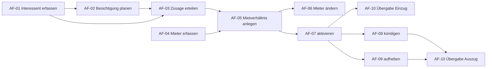

# Anwendungsfälle – Vermietung (Leitfaden Schritt 2)

Die Routen aus `bestand.md` sind zu fachlichen Anwendungsfällen gebündelt: **Wer will was erreichen?**
Reine Anzeigen ohne Fachlogik sind keine eigenen Anwendungsfälle; sie stehen unten bei »Zugeordnete Ansichten«.

Nummerierung: AF-01 bis AF-10 für die Vermietung. Bestand und Meldungen/Aufgaben folgen ab AF-11 (siehe Logbuch).

## Akteure

| Akteur | Benutzer / Rolle im Altsystem | Aufgabe | Quelle |
|---|---|---|---|
| Sachbearbeitung Vermietung | `vermieter` / `ROLE_LETTING_MANAGER` | betreut Interessenten, Verträge, Übergaben | README (»Vermietung«), Fixtures |
| Objektverwaltung | `verwalter` / `ROLE_PROPERTY_MANAGER` | betreut Objekte und Einheiten; in der Vermietung nur angrenzend | README (»Objektverwaltung«) |
| Administration | `admin` / `ROLE_ADMIN` | alle Rechte; als einzige Rolle sieht sie »Aufhebung / fristlos« | `tenancy/show.html.twig` |

> Das Altsystem prüft die Rollen nicht (alle Routen nur `ROLE_USER`). Die Zuordnung Akteur → Anwendungsfall ist
> deshalb eine **Annahme** aus den Rollennamen und ist mit dem Fachbereich zu klären (Logbuch F-01).

## Anwendungsfälle

| Nr. | Anwendungsfall | Akteur | Ziel (aus Sicht des Akteurs, ein Satz) | Routen | Bereich |
|---|---|---|---|---|---|
| AF-01 | Interessent erfassen und pflegen | Sachbearbeitung Vermietung | Ich halte jede Mietanfrage mit Kontakt und gewünschter Einheit fest und pflege ihren Stand bis zur Bewerbung oder Absage, damit keine Anfrage verloren geht. | `prospect_new`, `prospect_edit` | Vermietung |
| AF-02 | Besichtigung planen | Sachbearbeitung Vermietung | Ich vereinbare mit einem Interessenten einen Besichtigungstermin für eine Einheit, damit er sie ansehen kann und der Termin im Kalender steht. | `viewing_new` | Vermietung |
| AF-03 | Zusage erteilen | Sachbearbeitung Vermietung | Ich sage einem Interessenten die Einheit zu, damit er als Mieter übernommen und die Einheit für ihn reserviert wird. | `prospect_accept` | Vermietung |
| AF-04 | Mieter erfassen und pflegen | Sachbearbeitung Vermietung | Ich lege einen Mieter an oder ändere seine Daten, damit er Vertragspartner eines Mietverhältnisses werden kann. | `tenant_new`, `tenant_edit` | Vermietung |
| AF-05 | Mietverhältnis anlegen | Sachbearbeitung Vermietung | Ich erstelle für eine freie oder reservierte Einheit einen Vertragsentwurf mit Mietern, Laufzeit, Miete und Kaution, damit der Vertrag unterschrieben werden kann. | `tenancy_new` | Vermietung |
| AF-06 | Mieter eines Mietverhältnisses ändern | Sachbearbeitung Vermietung | Ich nehme einen Mieter in ein Mietverhältnis auf oder entferne ihn, damit alle Vertragspartner richtig eingetragen sind. | `tenancy_tenant` | Vermietung |
| AF-07 | Mietverhältnis aktivieren | Sachbearbeitung Vermietung | Wenn der Vertrag unterschrieben ist, mache ich das Mietverhältnis wirksam, damit die Einheit als vermietet gilt, der Einzug geplant ist und die Miete gefordert wird. | `tenancy_activate` | Vermietung |
| AF-08 | Mietverhältnis kündigen | Sachbearbeitung Vermietung (Annahme) | Ich erfasse eine eingegangene Kündigung mit Datum, damit das Mietende nach Kündigungsfrist feststeht und die Rückgabe geplant wird. | `tenancy_terminate` | Vermietung |
| AF-09 | Mietverhältnis aufheben | Administration | Ich beende ein Mietverhältnis sofort zu einem gewählten Datum (Aufhebung oder fristlose Kündigung), damit die Rückgabe ohne Kündigungsfrist geplant werden kann. | `tenancy_terminate_immediately` | Vermietung |
| AF-10 | Übergabe protokollieren | Sachbearbeitung Vermietung | Ich halte beim Einzug und beim Auszug Zählerstände, Schlüssel und Mängel fest; mit dem Auszug endet das Mietverhältnis und die Einheit wird wieder frei oder geht in die Renovierung. | `handover_new` | Vermietung |

**Prüffrage:** Lässt sich jeder Anwendungsfall in einem Satz aus Sicht des Akteurs formulieren? – Ja, siehe Spalte »Ziel«.

## Zugeordnete Ansichten (kein eigener Anwendungsfall)

| Route | Was wird gezeigt? | gehört zu |
|---|---|---|
| `prospect_index` | Liste der Interessenten, Einstieg zu Besichtigung und Zusage | AF-01, AF-02, AF-03 |
| `viewing_index` | Liste der Besichtigungen | AF-02 |
| `tenant_index`, `tenant_show` | Liste, Suche und Detail der Mieter | AF-04 |
| `tenancy_index` | Liste der Mietverhältnisse mit Filter (laufende, Entwürfe, …) | AF-05 bis AF-10 (Einstieg) |
| `tenancy_show` | Detail eines Mietverhältnisses; alle Aktionen AF-06 bis AF-10 starten hier | AF-05 bis AF-10 (Einstieg) |

## Ablauf der Anwendungsfälle

## Betrachtet, aber kein eigener Anwendungsfall

| Kandidat | Warum nicht eigenständig | Entscheidung |
|---|---|---|
| Interessent absagen | keine eigene Route; nur Statuswert »Absage« im Formular von AF-01 | Teil von AF-01; ggf. im Zielsystem eigener AF (Logbuch E-04) |
| Besichtigung durchführen / absagen | Status existiert, aber keine Aktion im Altsystem | fehlender Anwendungsfall → offene Frage F-04 |
| Kaution verbuchen (`TenancyService::bookDeposit()`) | Methode ohne Route, wird nirgends aufgerufen | nicht aufgenommen; Abrechnung (optional) |
