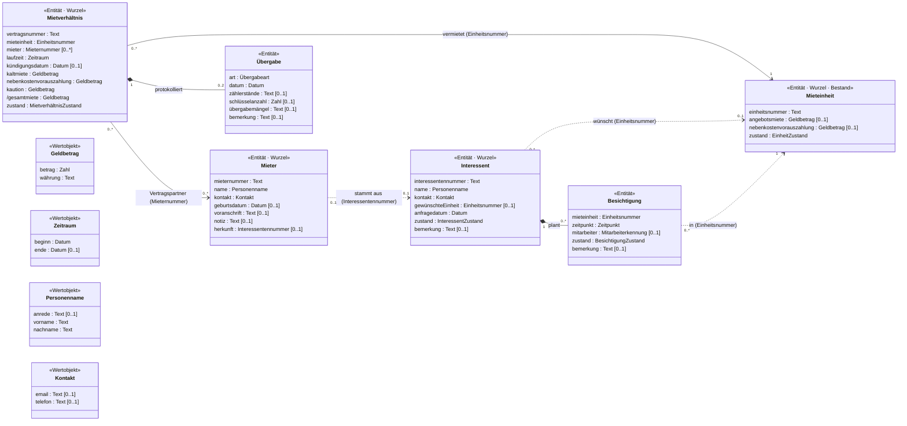
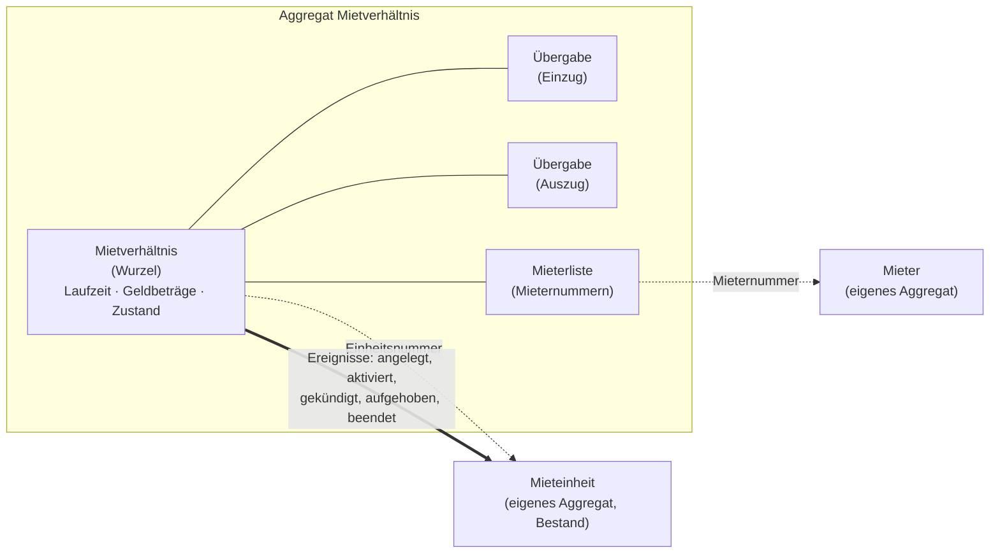

# Fachmodell – Vermietung (Leitfaden Schritte 5 und 8)

Technologieunabhängiges Modell der **Vermietung** – abgeleitet aus Code, Glossar und Regelkatalog.
Im Modell (Klassendiagramm, Aggregate) stehen keine Begriffe aus PHP, Doctrine, Symfony oder der Oberfläche.
Nur die Zuordnungstabellen nennen in der ersten Spalte das Feld im Code – als Fundstelle.

Begriffe: siehe `glossar.md`. Zustände: siehe `verhalten.md`. Regeln: siehe `regelkatalog.md`.
Bestand und Meldungen/Aufgaben folgen, sobald dort die Schritte 1–4 erledigt sind (Logbuch).

---

## Schritt 5: Bausteine bestimmen

Für jede Klasse und jedes Feld drei Fragen:
1. Ist es technisch (id, version, Zeitstempel, CSS-Klasse)? → **weglassen**
2. Hat es eine eigene Identität, die über Änderungen hinweg gleich bleibt? → **Entität**
3. Wird es nur durch seine Werte bestimmt (zwei gleiche sind austauschbar)? → **Wertobjekt**

### Mietverhältnis (`Tenancy`)

| Klasse / Feld (Code) | Fachlicher Name | Baustein | Typ | Multiplizität | Begründung |
|---|---|---|---|---|---|
| `Tenancy` | Mietverhältnis | Entität | – | – | bleibt dasselbe, auch wenn sich Miete, Mieter oder Zustand ändern |
| `Tenancy::id` | – | technisch | – | – | weggelassen; Identität ist die Vertragsnummer |
| `Tenancy::contractNumber` | Vertragsnummer | Identität | Text (`MV-` + 5 Ziffern) | 1 | eindeutig (Spalte `unique`), Fachleute nennen das Mietverhältnis so (REGEL-17) |
| `Tenancy::unit` | Mieteinheit | Verweis auf anderes Aggregat | Einheitsnummer | 1 | die Mieteinheit hat eigene Regeln und gehört zum Bestand → nur Verweis über die Identität (E-17) |
| `Tenancy::tenants` | Mieter | Verweis auf anderes Aggregat | Mieternummer | 0..* (laufend: 1..*) | der Mieter lebt länger als ein Mietverhältnis → eigenes Aggregat (E-16); Mindestanzahl siehe REGEL-21 |
| `Tenancy::startDate` + `Tenancy::endDate` | Laufzeit (Mietbeginn, Mietende) | Attribut | Wertobjekt **Zeitraum** | 1 | im Code zwei lose Felder; nur gemeinsam sinnvoll (Ende ≥ Beginn, REGEL-16) |
| `Tenancy::noticeDate` | Kündigungsdatum | Attribut | Datum | 0..1 | nur bei gekündigtem Mietverhältnis gesetzt |
| `Tenancy::coldRent` | Kaltmiete | Attribut | Wertobjekt **Geldbetrag** | 1 | nur durch Betrag und Währung bestimmt |
| `Tenancy::serviceChargeAdvance` | Nebenkostenvorauszahlung | Attribut | Wertobjekt **Geldbetrag** | 1 | wie Kaltmiete |
| `Tenancy::deposit` | Kaution | Attribut | Wertobjekt **Geldbetrag** | 1 | in der Datenbank optional, wird beim Anlegen aber immer belegt (REGEL-18) |
| `Tenancy::getTotalRent()` | Gesamtmiete | abgeleitetes Attribut | Wertobjekt **Geldbetrag** | 1 | = Kaltmiete + Nebenkostenvorauszahlung; wird nicht gespeichert |
| `Tenancy::status` | Zustand | Attribut | Aufzählung **MietverhältnisZustand** | 1 | im Code freie Zeichenkette; Werte und Übergänge in `verhalten.md` |
| `Tenancy::noticeGiven` | – | weggelassen (redundant) | – | – | doppelt zum Zustand, wird nur bei der Aufhebung gesetzt (Ticket #213) – Befund, E-14 |
| `Tenancy::handovers` | Übergaben | Teil des Aggregats | Entität **Übergabe** | 0..2 | gehört zum Mietverhältnis, wird nur über das Mietverhältnis geändert (Schritt 8) |

### Übergabe (`Handover`)

| Klasse / Feld (Code) | Fachlicher Name | Baustein | Typ | Multiplizität | Begründung |
|---|---|---|---|---|---|
| `Handover` | Übergabe | Entität (lokal im Aggregat Mietverhältnis) | – | – | ein Protokoll, das nachträglich ergänzt werden kann; innerhalb des Mietverhältnisses durch seine Art eindeutig (höchstens ein Einzug, ein Auszug – E-15) |
| `Handover::id` | – | technisch | – | – | weggelassen |
| `Handover::tenancy` | – | weggelassen | – | – | ergibt sich aus der Zugehörigkeit zum Aggregat |
| `Handover::type` | Art | Attribut, lokale Identität | Aufzählung **Übergabeart** (Einzug, Auszug) | 1 | – |
| `Handover::date` | Übergabedatum | Attribut | Datum | 1 | – |
| `Handover::meterReadings` | Zählerstände | Attribut | Text | 0..1 | im Altsystem Freitext; ein Wertobjekt Zählerstand (Zähler, Stand, Einheit) wäre fachlich besser – offene Frage F-14 |
| `Handover::keyCount` | Schlüsselanzahl | Attribut | Zahl (ganz, ≥ 0) | 0..1 | – |
| `Handover::defects` | Übergabemängel | Attribut | Text | 0..1 | bei Auszug entscheidet »vorhanden / nicht vorhanden« über Renovierung (REGEL-26) |
| `Handover::remarks` | Bemerkung | Attribut | Text | 0..1 | – |

### Mieter (`Tenant`)

| Klasse / Feld (Code) | Fachlicher Name | Baustein | Typ | Multiplizität | Begründung |
|---|---|---|---|---|---|
| `Tenant` | Mieter | Entität | – | – | zwei Mieter mit gleichem Namen müssen unterschieden werden |
| `Tenant::id` | – | technisch | – | – | weggelassen |
| – (fehlt im Code) | Mieternummer | Identität | Text | 1 | **neu**: das Altsystem hat keine fachliche Nummer, nur die technische id; das Mietverhältnis braucht aber einen Verweis (E-16, Annahme) |
| `Tenant::salutation` + `firstName` + `lastName` | Name | Attribut | Wertobjekt **Personenname** | 1 | drei Felder, die nur gemeinsam einen Namen ergeben |
| `Tenant::email` + `phone` | Kontakt | Attribut | Wertobjekt **Kontakt** | 1 | Interessent und Mieter nutzen dieselbe Struktur |
| `Tenant::birthDate` | Geburtsdatum | Attribut | Datum | 0..1 | – |
| `Tenant::previousAddress` | Voranschrift | Attribut | Text | 0..1 | im Altsystem Freitext; als Wertobjekt Adresse erst, wenn der Bestand eine Adresse modelliert |
| `Tenant::notes` | Notiz | Attribut | Text | 0..1 | wird im Altsystem für »übernommen aus Interessent #…« missbraucht – dafür jetzt eigener Verweis |
| – (nur in `notes`) | Herkunft | Verweis | Interessentennummer | 0..1 | **neu**: macht die Zusage nachvollziehbar (REGEL-27, E-18) |
| `Tenant::tenancies` | – | weggelassen | – | – | Rückrichtung; das Mietverhältnis verweist auf den Mieter, nicht umgekehrt |

### Interessent (`Prospect`) und Besichtigung (`Viewing`)

| Klasse / Feld (Code) | Fachlicher Name | Baustein | Typ | Multiplizität | Begründung |
|---|---|---|---|---|---|
| `Prospect` | Interessent | Entität | – | – | eine Anfrage wird über Wochen fortgeschrieben und bleibt dieselbe |
| `Prospect::id` | – | technisch | – | – | weggelassen |
| – (fehlt im Code) | Interessentennummer | Identität | Text | 1 | **neu**, wie Mieternummer (E-16, Annahme) |
| `Prospect::name` | Name | Attribut | Wertobjekt **Personenname** | 1 | im Code ein Feld; die Zusage teilt es am letzten Leerzeichen in Vor- und Nachname – fehleranfällig (»Anna Maria von Berg«), deshalb gleich strukturiert erfassen (E-18) |
| `Prospect::email` + `phone` | Kontakt | Attribut | Wertobjekt **Kontakt** | 1 | – |
| `Prospect::unit` | gewünschte Einheit | Verweis auf anderes Aggregat | Einheitsnummer | 0..1 | – |
| `Prospect::requestDate` | Anfragedatum | Attribut | Datum | 1 | – |
| `Prospect::status` | Zustand | Attribut | Aufzählung **InteressentZustand** | 1 | Übergänge in `verhalten.md` |
| `Prospect::remark` | Bemerkung | Attribut | Text | 0..1 | – |
| `Viewing` | Besichtigung | Entität (lokal im Aggregat Interessent) | – | – | geplante Termine werden verschoben, durchgeführt oder abgesagt – bleibt dieselbe Besichtigung |
| `Viewing::id` | – | technisch | – | – | weggelassen |
| `Viewing::prospect` | – | weggelassen | – | – | ergibt sich aus der Zugehörigkeit zum Aggregat Interessent (E-19) |
| `Viewing::unit` | Mieteinheit | Verweis auf anderes Aggregat | Einheitsnummer | 1 | – |
| `Viewing::dateTime` | Besichtigungszeitpunkt | Attribut | Zeitpunkt (Datum + Uhrzeit) | 1 | – |
| `Viewing::employee` | Mitarbeiter | Verweis | Mitarbeiterkennung | 0..1 | der Mitarbeiter ist kein Teil der Vermietung; im Code ein Benutzerkonto (`User`) – Technik |
| `Viewing::status` | Zustand | Attribut | Aufzählung **BesichtigungZustand** | 1 | wird im Altsystem nie geändert (F-04) |
| `Viewing::remark` | Bemerkung | Attribut | Text | 0..1 | – |

### Mieteinheit (`RentalUnit`) – nur, was die Vermietung braucht

Die Mieteinheit gehört zum **Bestand** (`kontexte.md`). Hier stehen nur die Felder, die die Vermietung liest.

| Klasse / Feld (Code) | Fachlicher Name | Baustein | Typ | Multiplizität | Begründung |
|---|---|---|---|---|---|
| `RentalUnit` | Mieteinheit | Entität (eigenes Aggregat, Bestand) | – | – | – |
| `RentalUnit::unitNumber` | Einheitsnummer | Identität | Text | 1 | Fachleute sprechen von »WE 03 links« |
| `RentalUnit::coldRent` | Angebotsmiete | Attribut | Wertobjekt **Geldbetrag** | 0..1 | Vorschlag für die Kaltmiete (E-06) |
| `RentalUnit::serviceChargeAdvance` | Nebenkostenvorauszahlung (Angebot) | Attribut | Wertobjekt **Geldbetrag** | 0..1 | Vorschlag beim Anlegen |
| `RentalUnit::status` | Zustand | Attribut | Aufzählung **EinheitZustand** | 1 | – |
| `RentalUnit::id`, `version`, `cssClass`, `showInList`, `lastModified`, `lastModifiedBy` | – | technisch | – | – | weggelassen (Sperre, Darstellung, Protokoll) |
| `RentalUnit::area`, `type`, `floor`, `building` | Fläche, Nutzungsart, Geschoss, Gebäude | – | – | – | Sache des Bestands, wird dort modelliert |

### Wertobjekte

| Wertobjekt | Attribute | Regeln (immer gültig) | genutzt von |
|---|---|---|---|
| **Geldbetrag** | betrag : Zahl (2 Nachkommastellen), währung : Text | Betrag ≥ 0; Rechnen nur bei gleicher Währung (Altsystem: immer EUR) | Kaltmiete, Nebenkostenvorauszahlung, Kaution, Gesamtmiete, Angebotsmiete |
| **Zeitraum** | beginn : Datum, ende : Datum [0..1] | ende fehlt = unbefristet; wenn vorhanden: ende ≥ beginn (REGEL-16); »überschneidet sich mit« ist eine Operation des Zeitraums (REGEL-15) | Laufzeit |
| **Personenname** | anrede : Text [0..1], vorname : Text, nachname : Text | nachname nicht leer | Mieter, Interessent |
| **Kontakt** | e-mail : Text [0..1], telefon : Text [0..1] | e-mail, wenn vorhanden, in gültiger Form | Mieter, Interessent |

### Aufzählungen

| Aufzählung | Werte | Bemerkung |
|---|---|---|
| MietverhältnisZustand | Entwurf, aktiv, gekündigt, aufgehoben, beendet | Übergänge: `verhalten.md`; Sammelbegriff **laufend** = aktiv oder gekündigt (Glossar) |
| InteressentZustand | neu, Besichtigung geplant, Bewerbung eingegangen, zugesagt, abgesagt | Übergänge: `verhalten.md` |
| BesichtigungZustand | geplant, durchgeführt, abgesagt | – |
| Übergabeart | Einzug, Auszug | – |
| EinheitZustand | frei, reserviert, vermietet, gekündigt, Renovierung, gesperrt | gehört zum Bestand; »frei« statt »verfügbar« (E-08) |

### Klassendiagramm

Lesart: `*--` = Teil des Aggregats (wird mit der Wurzel gespeichert); `-->` / `..>` = Verweis auf ein anderes
Aggregat, nur über dessen Nummer. Die Wertobjekte sind als Typen der Attribute verwendet (z. B. `laufzeit : Zeitraum`).

**Prüffrage:** Enthält das Modell noch Begriffe aus PHP, Doctrine oder Symfony? – Nein. Technische Felder (id, version,
cssClass, showInList, lastModified…) sind weggelassen; `User` ist durch »Mitarbeiterkennung« ersetzt; die
Zeichenketten-Status sind Aufzählungen; `noticeGiven` ist weggelassen.

---

## Schritt 8: Aggregate schneiden

Vorgehen nach VL 4: (1) Welche Regeln gelten? (2) Welche Objekte muss eine Regel gleichzeitig prüfen?
(3) Über welches Objekt laufen alle Änderungen? (4) Alles andere nur über die Nummer.

### Welche Objekte prüft jede Regel?

| Regel | Kurzform | prüft gleichzeitig | → gehört zu |
|---|---|---|---|
| REGEL-16 | Mietende nicht vor Mietbeginn | Mietverhältnis (Laufzeit) | Aggregat Mietverhältnis |
| REGEL-17 | Vertragsnummer eindeutig | alle Mietverhältnisse | Ablage (Nummernvergabe) – kein Aggregat |
| REGEL-18 | Vorbelegung Miete und Kaution | Mietverhältnis; liest Angebotsmiete der Mieteinheit | Aggregat Mietverhältnis (Angebotsmiete wird als Wert übergeben) |
| REGEL-20 | aktivieren | Mietverhältnis, Mieterliste | Aggregat Mietverhältnis |
| REGEL-21 | laufendes Mietverhältnis hat mindestens einen Mieter | Mietverhältnis, Mieterliste | Aggregat Mietverhältnis |
| REGEL-22 | Mieterliste ändern | Mietverhältnis, Mieterliste | Aggregat Mietverhältnis |
| REGEL-23 | kündigen | Mietverhältnis | Aggregat Mietverhältnis |
| REGEL-24 | aufheben | Mietverhältnis | Aggregat Mietverhältnis |
| REGEL-25 | Einzug protokollieren | Mietverhältnis, Übergaben | Aggregat Mietverhältnis |
| REGEL-26 | Auszug protokollieren | Mietverhältnis, Übergaben | Aggregat Mietverhältnis |
| REGEL-27 | Zusage | Interessent | Aggregat Interessent (Folgen für Mieter und Mieteinheit über Ereignis) |
| REGEL-28 | Besichtigung planen | Interessent, Besichtigung | Aggregat Interessent |
| REGEL-29 | Zustandsfolge Interessent | Interessent | Aggregat Interessent |
| REGEL-01 | Anlegen nur für freie oder eigens reservierte Mieteinheit | Mieteinheit **und** neues Mietverhältnis | **mehrere Aggregate** → Anwendungsschicht |
| REGEL-15 | keine Überschneidung der Laufzeiten einer Mieteinheit | **mehrere** Mietverhältnisse derselben Einheit | **mehrere Aggregate** → Anwendungsschicht (Domänendienst) |
| REGEL-19 | Zustand der Mieteinheit folgt dem Mietverhältnis | Mietverhältnis, Mieteinheit | **mehrere Aggregate** → Mieteinheit reagiert auf Ereignisse (E-17) |

### Aggregate

| Aggregat | Wurzel | enthält | Invarianten / Regeln | Befehle | Ereignisse |
|---|---|---|---|---|---|
| **Mietverhältnis** | Mietverhältnis | Übergaben (Einzug, Auszug); Mieterliste (nur Mieternummern); Laufzeit, Geldbeträge (Wertobjekte) | REGEL-16, 18, 20, 21, 22, 23, 24, 25, 26 | anlegen, Mieter aufnehmen, Mieter entfernen, aktivieren, kündigen, aufheben, Einzug protokollieren, Auszug protokollieren | Mietverhältnis angelegt, aktiviert, gekündigt, aufgehoben, beendet; Einzug protokolliert |
| **Interessent** | Interessent | Besichtigungen | REGEL-27, 28, 29 | erfassen, ändern, Besichtigung planen, Besichtigung durchführen*, Besichtigung absagen*, Bewerbung erfassen, zusagen, absagen | Besichtigung geplant, Interessent zugesagt, Interessent abgesagt |
| **Mieter** | Mieter | Personenname, Kontakt (Wertobjekte) | nachname nicht leer (Wertobjekt Personenname) | erfassen, ändern | Mieter erfasst |
| **Mieteinheit** *(Bestand)* | Mieteinheit | – (Details im Bestand) | Zustandsfolge der Einheit (`verhalten.md`) | reservieren, als vermietet markieren, als gekündigt markieren, freigeben, in Renovierung geben | – |

\* neu, im Altsystem nicht vorhanden (F-04)

### Regeln über mehrere Aggregate

| Regel | Wer prüft? | Ablauf |
|---|---|---|
| REGEL-01 | Anwendungsschicht beim Befehl »Mietverhältnis anlegen« | liest den Zustand der Mieteinheit (und für wen sie reserviert ist), dann erst wird das Mietverhältnis angelegt |
| REGEL-15 | Anwendungsschicht beim Anlegen (Domänendienst »Belegung prüfen«) | lädt die Laufzeiten aller nicht-Entwurf-Mietverhältnisse der Einheit aus der Ablage und prüft sie mit `Zeitraum überschneidet sich mit` |
| REGEL-19 | Mieteinheit reagiert auf Ereignisse | angelegt → reserviert · aktiviert → vermietet · gekündigt / aufgehoben → gekündigt · beendet → frei oder Renovierung |
| REGEL-27 (Folgen) | Anwendungsschicht reagiert auf »Interessent zugesagt« | legt einen Mieter mit Herkunft = Interessentennummer an; reserviert die gewünschte Einheit, wenn sie frei ist |
| REGEL-20 (Folgen) | Termine und Abrechnung reagieren auf »Mietverhältnis aktiviert« | Übergabetermin (Einzug) anlegen; erste Sollstellungen erzeugen |
| REGEL-23, 24 (Folgen) | Termine reagieren auf »gekündigt« / »aufgehoben« | Übergabetermin (Auszug) am Mietende anlegen |

### Aggregat Mietverhältnis

Invarianten im Aggregat: Ende ≥ Beginn · ein laufendes Mietverhältnis hat mindestens einen Mieter ·
höchstens ein Einzug und ein Auszug · Zustandsübergänge nur nach `verhalten.md`.
Regel über mehrere Aggregate: keine Überschneidung der Laufzeiten einer Einheit (REGEL-15).

Im Altsystem ändern `TenancyController::terminate()` und alle Methoden von `TenancyService` Mietverhältnis
**und** Mieteinheit in einer Methode – es gibt keine Grenze.

### Entscheidungen zu den Aggregatgrenzen

Ausführlich im Logbuch (`log.md`, E-16 bis E-19). Kurzfassung:

| Frage | Alternative A | Alternative B | gewählt |
|---|---|---|---|
| Mieteinheit im Aggregat Mietverhältnis? | ja – Zustand der Einheit stimmt immer | nein – getrennt, Abstimmung über Ereignisse | **B** (E-17): die Einheit hat eigene Zustände (Renovierung, gesperrt) und gehört zum Bestand; ein kurzes Zeitfenster ist unkritisch |
| Mieter im Aggregat Mietverhältnis? | ja – Mieterdaten mit dem Vertrag speichern | nein – eigenes Aggregat, Mieterliste mit Mieternummern | **B** (E-16): ein Mieter kann mehrere Mietverhältnisse haben (Umzug im Bestand) und wird auch von Meldungen genutzt |
| Besichtigung im Aggregat Interessent? | ja – Planen ändert Besichtigung und Zustand des Interessenten zusammen | nein – eigenes Aggregat, Zustand über Ereignis | **A** (E-19): REGEL-28 prüft beide gleichzeitig; ein Interessent hat nur wenige Besichtigungen |
| Übergabe als eigenes Aggregat? | ja | nein – Teil des Mietverhältnisses | **nein** (E-15): der Auszug ändert den Zustand des Mietverhältnisses (REGEL-26) – muss gemeinsam geprüft werden |

**Prüffrage:** Gehört jede Regel zu genau einem Aggregat? – Ja, bis auf REGEL-01, REGEL-15 und REGEL-19. Diese drei
betreffen mehrere Aggregate; sie sind bewusst der Anwendungsschicht bzw. der Reaktion auf Ereignisse zugeordnet
(siehe oben). REGEL-17 ist eine Aufgabe der Ablage.

---

## Offene Fragen an den Fachbereich

Siehe Logbuch (`log.md`), F-01 bis F-17. Für dieses Modell besonders wichtig:

- F-11 Wie wird ein Entwurf verworfen, der nie unterschrieben wird? Heute bleibt die Einheit dann dauerhaft reserviert.
- F-12 Darf während der Kündigungsfrist schon das Mietverhältnis des Nachmieters angelegt werden?
- F-14 Sollen Zählerstände strukturiert erfasst werden (Zähler, Stand, Ablesedatum)?
- F-16 Gibt es eine fachliche Mieter- bzw. Interessentennummer, die wir übernehmen sollten?
