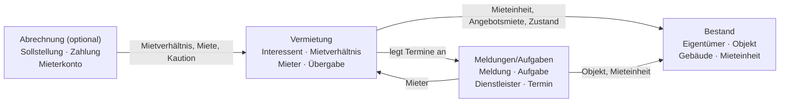

# Kontexte (Leitfaden Schritt 4)

Anwendungsfälle und Begriffe werden abgegrenzten Kontexten (Bounded Contexts) zugeordnet.
Wo ein Begriff in zwei Bereichen etwas anderes bedeutet, liegt eine Kontextgrenze.

Grundlage ist der Vorschlag aus VL 3 (Folie 14). Ausgearbeitet ist bisher die **Vermietung**;
Bestand und Meldungen/Aufgaben werden zu Hause ergänzt (Pflichtbereiche), Abrechnung ist optional.

## Übersicht

| Kontext | Zentrale Begriffe | Anwendungsfälle | nutzt Daten von |
|---|---|---|---|
| Bestand | Eigentümer, Objekt, Gebäude, Mieteinheit, Angebotsmiete, Zustand Mieteinheit | *ab AF-11 (zu Hause)* | – |
| **Vermietung** | Interessent, Besichtigung, Zusage, Mieter, Mietverhältnis, Kündigung, Aufhebung, Übergabe | AF-01 bis AF-10 | Bestand (Mieteinheit, Angebotsmiete, Zustand Mieteinheit); Meldungen/Aufgaben (Mitarbeiter für die Besichtigung) |
| Meldungen/Aufgaben | Meldung, Aufgabe, Dienstleister, Termin | *zu Hause* | Bestand (Objekt, Mieteinheit); Vermietung (Mieter als meldende Person) |
| Abrechnung (optional) | Sollstellung, Zahlung, Mieterkonto, Buchung | – | Vermietung (Mietverhältnis, Kaltmiete, Nebenkostenvorauszahlung, Kaution, Mietbeginn/-ende) |

Der Termin steht nach dem Vorschlag aus VL 3 bei Meldungen/Aufgaben. Die Vermietung **legt** dort Termine an
(Besichtigung, Übergabe), sie besitzt sie nicht.

## Zuordnung Anwendungsfall → Kontext

| Anwendungsfall | Kontext | Begründung |
|---|---|---|
| AF-01 Interessent erfassen und pflegen | Vermietung | Interessent existiert nur bis zur Zusage – reine Vermietungsaufgabe |
| AF-02 Besichtigung planen | Vermietung | Besichtigung gehört zum Interessenten; der Kalendereintrag ist nur eine Folge (Termin) |
| AF-03 Zusage erteilen | Vermietung | Übergang Interessent → Mieter |
| AF-04 Mieter erfassen und pflegen | Vermietung | Mieter ist Vertragspartner; im Altsystem unter »Stammdaten«, das Menü ist aber keine Kontextgrenze (VL 3, Folie 13) |
| AF-05 Mietverhältnis anlegen | Vermietung | – |
| AF-06 Mieter eines Mietverhältnisses ändern | Vermietung | – |
| AF-07 Mietverhältnis aktivieren | Vermietung | löst Folgen in Bestand, Termine und Abrechnung aus, die Entscheidung selbst ist Vermietung |
| AF-08 Mietverhältnis kündigen | Vermietung | – |
| AF-09 Mietverhältnis aufheben | Vermietung | – |
| AF-10 Übergabe protokollieren | Vermietung | Übergabe beendet bzw. startet die Nutzung durch den Mieter |

**Prüffrage:** Gehört jeder Anwendungsfall zu genau einem Kontext? – Ja.

## Begriffe, die an der Grenze ihre Bedeutung ändern

| Begriff | Bestand | Vermietung | Meldungen/Aufgaben | Abrechnung |
|---|---|---|---|---|
| **Mieter** | – | Vertragspartner eines Mietverhältnisses | Person, die einen Schaden meldet und informiert wird (`Issue::tenant`) | Inhaber eines Mieterkontos: was ist zu zahlen, was ist gezahlt? |
| **Mietverhältnis** | – (die Einheit kennt nur »belegt / nicht belegt«) | Vertrag über die Zeit mit Zuständen | – | **Mieterkonto**: Folge von Sollstellungen und Zahlungen (»Mieterkonto MV-01001«) |
| **Kaltmiete** | Angebotsmiete der Einheit (`RentalUnit::coldRent`) | vereinbarte Kaltmiete im Mietverhältnis (`Tenancy::coldRent`) | – | Betrag einer Sollstellung (Position `COLD_RENT`) |
| **Mieteinheit** | Wohnung/Gewerbe mit Fläche, Lage, Ausstattung | nur: was wird vermietet, ist sie frei? | Ort eines Schadens | Bezug einer Buchung |
| **gekündigt** | Zustand der Mieteinheit (`RentalUnit::NOTICE_GIVEN`): Einheit wird bald frei | Zustand des Mietverhältnisses (`Tenancy::NOTICE_GIVEN`): Kündigung erklärt, läuft noch | – | – |
| **Mangel** | – | Übergabemangel: Schaden, der bei der Übergabe festgestellt wird | Gegenstand einer Meldung (Schaden, der gemeldet und behoben wird) | – |
| **Termin** | – | Besichtigung bzw. Übergabe (fachliches Ereignis) | Kalendereintrag mit Uhrzeit und Dauer (`Appointment`) | – |

## Wer nutzt Daten von wem? (Kontextübersicht)

Pfeil = »nutzt Informationen von« bzw. »löst etwas aus in«.

## Beobachtungen im Altsystem an den Kontextgrenzen

| Stelle | Was passiert | Problem | Vorschlag (für Übung 4 prüfen) |
|---|---|---|---|
| `TenancyService::createTenancy()`, `activate()`, `recordHandover()`, `terminateImmediately()`; `TenancyController::terminate()`; `RentalService::acceptProspect()` | Vermietung setzt direkt den Zustand der Mieteinheit (reserviert, vermietet, gekündigt, frei, Renovierung) | Vermietung schreibt in den Bestand; derselbe Zustand wird an sechs Stellen gepflegt | Zustände reserviert/vermietet/gekündigt aus dem laufenden Mietverhältnis ableiten; Bestand behält nur Renovierung/gesperrt |
| `TenancyService::activate()` | erzeugt Sollstellungen | Vermietung kennt Details der Abrechnung (Fälligkeit am 3.) | Abrechnung reagiert auf »Mietverhältnis aktiviert« |
| `AppointmentService::createHandover()`, `RentalService::planViewing()` | Vermietung legt Termine an | Termin verweist nur über `refType`/`refId` (Text + Zahl) zurück | Verweis über die Identität (Vertragsnummer, Einheit) |
| `TenancyController::show()` | zeigt das Mieterkonto auf der Seite des Mietverhältnisses | zwei Kontexte auf einer Seite | nur Oberfläche – kein Grund, die Modelle zu vermischen |
| Menü »Stammdaten → Mieter« | Mieter neben Eigentümer und Objekten | Menü suggeriert Bestand | Mieter gehört zur Vermietung |
