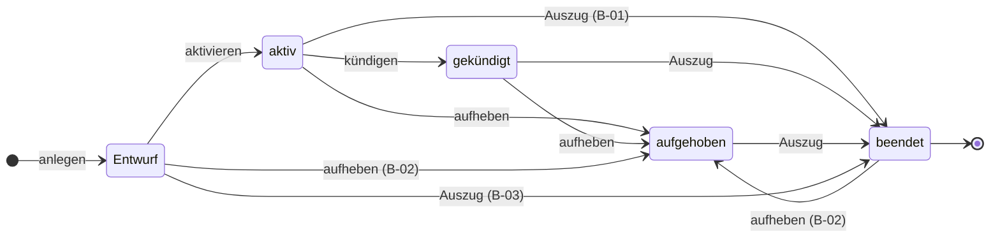
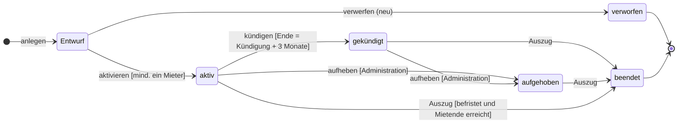
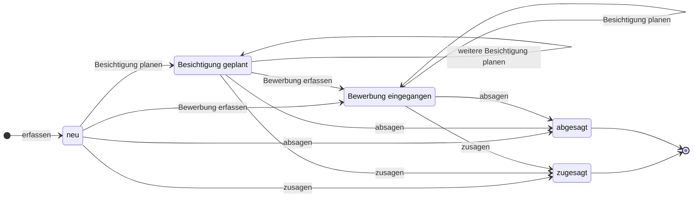
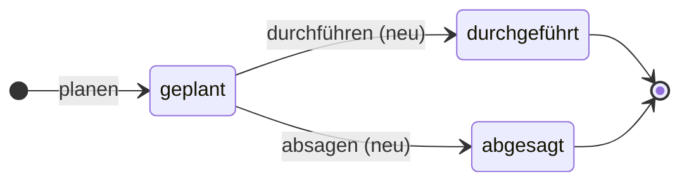
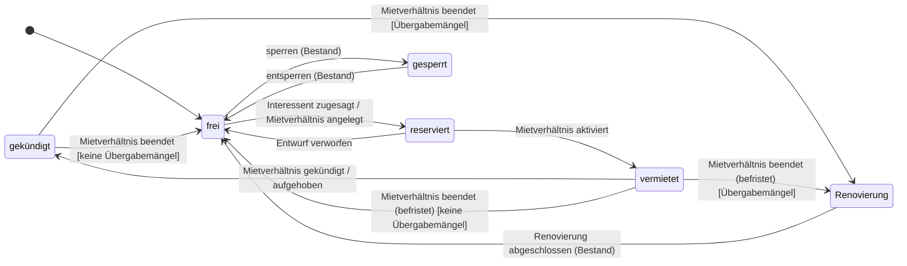

# Verhalten – Vermietung (Leitfaden Schritt 6)

Zustände und Übergänge der Vermietung. Kein Diagramm davon gibt es im Altsystem – es entsteht erst, wenn man
alle Stellen sucht, an denen ein Zustand gesetzt wird.

**Eingabe:**

```
grep -n "const " src/Entity/Tenancy.php src/Entity/Handover.php src/Entity/RentalUnit.php
grep -n "STATUSES" -A 6 src/Entity/Prospect.php
grep -rn "setStatus(" src --include='*.php'
grep -rn "status" templates/tenancy templates/letting templates/unit
```

Gefundene Stellen (ohne Meldungen, Aufgaben, Abrechnung):

| Fundstelle | setzt |
|---|---|
| `TenancyService::createTenancy()` (Z. 78–79) | Mietverhältnis → Entwurf, Mieteinheit → reserviert |
| `TenancyService::activate()` (Z. 99, 102) | Mietverhältnis → aktiv, Mieteinheit → vermietet |
| `TenancyController::terminate()` (Z. 157, 159) | Mietverhältnis → gekündigt, Mieteinheit → gekündigt |
| `TenancyService::terminateImmediately()` (Z. 156, 158–159) | Mietverhältnis → aufgehoben, Merker `noticeGiven`, Mieteinheit → gekündigt |
| `TenancyService::recordHandover()` (Z. 138, 144) | bei Auszug: Mietverhältnis → beendet, Mieteinheit → frei / Renovierung |
| `RentalService::planViewing()` (Z. 26) | Interessent → Besichtigung geplant |
| `RentalService::acceptProspect()` (Z. 56, 58) | Interessent → zugesagt, Mieteinheit → reserviert (nur wenn frei) |
| `LettingController::handleProspectForm()` über `ProspectType` (Feld `status`) | Interessent → **jeder** Zustand (frei wählbar) |
| `RentalUnitController` über `RentalUnitType` (Feld `status`) | Mieteinheit → **jeder** Zustand (frei wählbar, Bestand) |
| `Viewing::$status` | nur Vorgabewert »geplant« – wird nirgends geändert |

Die Bedingungen der Oberfläche (welcher Button wann erscheint) stehen in `templates/tenancy/show.html.twig`
(Z. 25–49), `templates/letting/prospects.html.twig` (Z. 20) und `templates/unit/show.html.twig` (Z. 48).

---

## 1 Mietverhältnis

### Zustände

| Zustand | Code | Bedeutung | laufend? |
|---|---|---|---|
| Entwurf | `DRAFT` | angelegt, noch nicht unterschrieben | nein |
| aktiv | `ACTIVE` | unterschrieben, gilt | ja |
| gekündigt | `NOTICE_GIVEN` | Kündigung erklärt, läuft bis zum Mietende weiter | ja |
| aufgehoben | `TERMINATED` | sofort beendet (Aufhebung / fristlose Kündigung); Auszug steht noch aus | nein (Altsystem) – F-13 |
| beendet | `ENDED` | Auszug protokolliert, Endzustand | nein |

### Übergänge im Altsystem (Ist)

| Von | Nach | Ausgelöst durch | Bedingung im Code | Bedingung nur in der Oberfläche | Fundstelle |
|---|---|---|---|---|---|
| – (Start) | Entwurf | AF-05 Mietverhältnis anlegen | Einheit frei **oder** reserviert; kein laufendes Mietverhältnis der Einheit; keine Überschneidung der Laufzeit; Mietende ≥ Mietbeginn | Button nur bei Einheit »frei« | `TenancyController::new()`, `TenancyService::createTenancy()` |
| Entwurf | aktiv | AF-07 Mietverhältnis aktivieren | Zustand Entwurf; mindestens ein Mieter | Button nur bei Entwurf | `TenancyService::activate()` |
| aktiv | gekündigt | AF-08 Mietverhältnis kündigen | Zustand aktiv; Mietende = Kündigungsdatum + 3 Monate | Button nur bei aktiv **und** Merker `noticeGiven` = nein | `TenancyController::terminate()` |
| aktiv, gekündigt | aufgehoben | AF-09 Mietverhältnis aufheben | **keine** | Button nur bei aktiv/gekündigt **und** Rolle Administration | `TenancyService::terminateImmediately()` |
| Entwurf, aufgehoben, beendet | aufgehoben | AF-09 (direkter Aufruf) | **keine** | – (kein Button) | `TenancyService::terminateImmediately()` – **Befund B-02** |
| aktiv, gekündigt, aufgehoben | beendet | AF-10 Übergabe (Auszug) | **keine Prüfung des Zustands** | Button bei aktiv/gekündigt/aufgehoben | `TenancyService::recordHandover()` |
| Entwurf, beendet | beendet | AF-10 Übergabe (Auszug, direkter Aufruf) | **keine** | – (kein Button) | `TenancyService::recordHandover()` – **Befund B-03** |
| aktiv, gekündigt, aufgehoben | *(unverändert)* | AF-10 Übergabe (Einzug) | keine; beliebig oft | Button wie oben | `TenancyService::recordHandover()` |



*Ist-Diagramm: so verhält sich das Altsystem, wenn man die Routen direkt aufruft. Kanten mit (B-…) sind Befunde.*

### Befunde

| Nr. | Befund | Fundstelle | Folge |
|---|---|---|---|
| B-01 | Die Kante **aktiv → beendet**: ein nie gekündigtes Mietverhältnis wird durch einen Auszug beendet. | `recordHandover()` prüft den Zustand nicht | Mietverhältnis endet ohne Kündigung oder Aufhebung |
| B-02 | Die Aufhebung prüft keinen Zustand und keine Rolle – ein **Entwurf** oder ein **beendetes** Mietverhältnis kann aufgehoben werden; die Rolle wird nur im Template geprüft. | `terminateImmediately()`, `tenancy/show.html.twig` Z. 38 | beendetes Mietverhältnis wird »wiederbelebt«, Einheit → gekündigt, neuer Rückgabetermin |
| B-03 | Ein Auszug ist auch bei **Entwurf** möglich (direkter Aufruf); die Einheit wird dann frei, obwohl nie jemand eingezogen ist. | `recordHandover()` | Einheit wird frei, Entwurf wird beendet |
| B-04 | Ein **Entwurf** kann nicht verworfen werden (keine Route, kein Löschen) – die Einheit bleibt reserviert. | – (fehlt) | fehlender Übergang, F-11 |
| B-05 | Der Merker `noticeGiven` wird bei der Kündigung **nicht**, bei der Aufhebung **doch** gesetzt; das Template blendet mit ihm den Kündigungs-Button aus. Er ist doppelt zum Zustand. | `terminate()`, `terminateImmediately()`, `tenancy/show.html.twig` Z. 31 | Merker und Zustand können sich widersprechen (Fixture MV-00987: beendet + Merker) |
| B-06 | Ein Einzug kann beliebig oft und auch nach der Kündigung protokolliert werden. | `recordHandover()` | mehrere Einzugsprotokolle |
| B-07 | Ein **befristetes** aktives Mietverhältnis bleibt nach Ablauf des Mietendes »aktiv«, bis jemand den Auszug protokolliert. Es gibt keinen zeitgesteuerten Übergang. | – | Liste »laufende« zeigt abgelaufene Verträge |
| B-08 | Die Kündigung überschreibt ein vorhandenes Mietende – auch wenn ein befristetes Mietverhältnis früher endet. | `terminate()` Z. 156 | Kündigung verlängert ein befristetes Mietverhältnis |

### Übergänge im Zielmodell (Soll)

Entscheidungen: E-14, E-20 bis E-26 im Logbuch (`log.md`).

| Von | Nach | Ausgelöst durch (Befehl) | Bedingung | Ereignis | Regel |
|---|---|---|---|---|---|
| – (Start) | Entwurf | AF-05 anlegen | Einheit frei oder für diesen Mieter reserviert; keine Überschneidung; Ende ≥ Beginn | Mietverhältnis angelegt | REGEL-01, 15, 16, 18 |
| Entwurf | verworfen | verwerfen *(neu, Annahme)* | Zustand Entwurf | Entwurf verworfen | F-11 |
| Entwurf | aktiv | AF-07 aktivieren | Zustand Entwurf; mindestens ein Mieter | Mietverhältnis aktiviert | REGEL-20 |
| aktiv | gekündigt | AF-08 kündigen | Zustand aktiv; Kündigungsdatum angegeben | Mietverhältnis gekündigt | REGEL-23 |
| aktiv, gekündigt | aufgehoben | AF-09 aufheben | Zustand aktiv oder gekündigt; Akteur Administration; Ende ≥ Beginn | Mietverhältnis aufgehoben | REGEL-24 |
| gekündigt, aufgehoben | beendet | AF-10 Auszug protokollieren | Zustand gekündigt oder aufgehoben; noch kein Auszug | Mietverhältnis beendet | REGEL-26 |
| aktiv | beendet | AF-10 Auszug protokollieren | **nur befristet** (Mietende gesetzt) und Mietende erreicht | Mietverhältnis beendet | REGEL-26, E-21 |
| aktiv, gekündigt | *(unverändert)* | AF-10 Einzug protokollieren | noch kein Einzug | Einzug protokolliert | REGEL-25 |



Hinweis: **laufend** (Glossar) = aktiv oder gekündigt – ein Sammelbegriff, kein eigener Zustand.

**Prüffrage:** Hat jeder Zustand mindestens einen Weg hinein und – außer Endzuständen – einen hinaus?

| Zustand | hinein | hinaus | erfüllt? |
|---|---|---|---|
| Entwurf | anlegen | aktivieren, verwerfen | ja (Altsystem: nur aktivieren – ein Entwurf ohne Unterschrift bleibt für immer, B-04) |
| aktiv | aktivieren | kündigen, aufheben, Auszug (befristet) | ja |
| gekündigt | kündigen | aufheben, Auszug | ja |
| aufgehoben | aufheben | Auszug | ja |
| beendet | Auszug | – (Endzustand) | ja |
| verworfen | verwerfen | – (Endzustand) | ja (neu) |

---

## 2 Interessent

### Übergänge im Altsystem (Ist)

| Von | Nach | Ausgelöst durch | Bedingung im Code | Bedingung nur in der Oberfläche | Fundstelle |
|---|---|---|---|---|---|
| – (Start) | neu | AF-01 Interessent erfassen | keine (Vorgabewert, im Formular aber änderbar) | – | `Prospect::$status`, `LettingController::newProspect()` |
| **jeder** | Besichtigung geplant | AF-02 Besichtigung planen | **keine** – auch aus »Bewerbung eingegangen«, »zugesagt«, »abgesagt« | Button nur bei neu / Besichtigung geplant / Bewerbung eingegangen | `RentalService::planViewing()` |
| **jeder** | zugesagt | AF-03 Zusage erteilen | **keine** – eine zweite Zusage legt einen zweiten Mieter an | Button nur bei neu / Besichtigung geplant / Bewerbung eingegangen | `RentalService::acceptProspect()` |
| **jeder** | **jeder** (auch Bewerbung eingegangen, abgesagt) | AF-01 Interessent pflegen | **keine** – Zustand frei im Formular wählbar | – | `LettingController::editProspect()`, `ProspectType` |

Befunde: B-09 Zustand frei wählbar (z. B. »zugesagt« → »neu«); B-10 Besichtigung setzt »Bewerbung eingegangen«
zurück; B-11 doppelte Zusage → doppelter Mieter (F-03); B-12 »Bewerbung eingegangen« und »Absage« haben keine eigene Aktion.

### Übergänge im Zielmodell (Soll)

| Von | Nach | Befehl | Bedingung | Ereignis | Regel |
|---|---|---|---|---|---|
| – (Start) | neu | erfassen | – | Interessent erfasst | – |
| neu | Besichtigung geplant | Besichtigung planen | – | Besichtigung geplant | REGEL-28 |
| Besichtigung geplant, Bewerbung eingegangen | *(unverändert)* | Besichtigung planen | weitere Besichtigung | Besichtigung geplant | REGEL-28 |
| neu, Besichtigung geplant | Bewerbung eingegangen | Bewerbung erfassen *(neu)* | – | Bewerbung eingegangen | REGEL-29 |
| neu, Besichtigung geplant, Bewerbung eingegangen | zugesagt | zusagen | noch nicht zugesagt oder abgesagt | Interessent zugesagt | REGEL-27 |
| neu, Besichtigung geplant, Bewerbung eingegangen | abgesagt | absagen *(neu)* | – | Interessent abgesagt | REGEL-29 |



**Prüffrage:** Jeder Zustand hat einen Weg hinein; neu, Besichtigung geplant und Bewerbung eingegangen haben einen
Weg hinaus; zugesagt und abgesagt sind Endzustände. – erfüllt.

---

## 3 Besichtigung

| Von | Nach | Ausgelöst durch | Bedingung | Fundstelle |
|---|---|---|---|---|
| – (Start) | geplant | AF-02 Besichtigung planen | – | `Viewing::$status`, `RentalService::planViewing()` |
| geplant | durchgeführt | **fehlt** | – | – (F-04) |
| geplant | abgesagt | **fehlt** | – | – (F-04) |

Soll (Annahme, F-04): Besichtigung durchführen und absagen werden eigene Befehle am Aggregat Interessent.



**Prüffrage:** Im Altsystem hat »geplant« keinen Weg hinaus und »durchgeführt« / »abgesagt« keinen Weg hinein –
**nicht erfüllt**. Im Soll-Modell erfüllt.

---

## 4 Mieteinheit – Zustandswechsel, die die Vermietung auslöst

Die Mieteinheit gehört zum Bestand; ihre Zustände werden dort vollständig modelliert. Hier nur die Wechsel, die die
Vermietung im Altsystem **direkt** schreibt (Kontextgrenze, siehe `kontexte.md`).

| Von | Nach | Auslöser in der Vermietung | Bedingung im Code | Fundstelle |
|---|---|---|---|---|
| frei | reserviert | AF-03 Zusage | nur wenn frei | `RentalService::acceptProspect()` |
| frei, reserviert | reserviert | AF-05 Mietverhältnis anlegen | Einheit frei oder reserviert | `TenancyService::createTenancy()` |
| *jeder* | vermietet | AF-07 aktivieren | keine Prüfung der Einheit | `TenancyService::activate()` |
| *jeder* | gekündigt | AF-08 kündigen, AF-09 aufheben | keine Prüfung der Einheit | `TenancyController::terminate()`, `TenancyService::terminateImmediately()` |
| *jeder* | frei / Renovierung | AF-10 Auszug | Renovierung, wenn Übergabemängel eingetragen | `TenancyService::recordHandover()` |
| *jeder* | *jeder* | Bestand: Einheit bearbeiten | keine – Zustand frei wählbar | `RentalUnitType` (Feld `status`) |

Soll (E-17): Die Mieteinheit ist ein eigenes Aggregat und **reagiert auf Ereignisse** der Vermietung:



*Renovierung abschließen, sperren und entsperren sind Befehle des Bestands – werden dort genauer modelliert.*

---

## 5 Fachliche Ereignisse

Befehl (Absicht, Gegenwart) → Regeln prüfen → Ereignis (ist passiert, Vergangenheit). Andere Bereiche reagieren auf
das Ereignis; das auslösende Aggregat muss sie nicht kennen.

| Ereignis | ausgelöst von (Aggregat, Befehl) | Inhalt | wer reagiert? | Reaktion | im Altsystem heute |
|---|---|---|---|---|---|
| Interessent zugesagt | Interessent · zusagen | Interessentennummer, Name, Kontakt, gewünschte Einheit | Vermietung (Mieter); Bestand (Mieteinheit) | Mieter anlegen (Herkunft = Interessent); Einheit reservieren, wenn frei | direkt in `acceptProspect()` |
| Besichtigung geplant | Interessent · Besichtigung planen | Einheitsnummer, Zeitpunkt, Mitarbeiter | Meldungen/Aufgaben (Termin) | Termin »Besichtigung« (30 Minuten) | direkt in `planViewing()` |
| Mietverhältnis angelegt | Mietverhältnis · anlegen | Vertragsnummer, Einheitsnummer, Laufzeit | Bestand | Einheit → reserviert | direkt in `createTenancy()` |
| Entwurf verworfen *(neu)* | Mietverhältnis · verwerfen | Vertragsnummer, Einheitsnummer | Bestand | Einheit → frei | fehlt |
| Mietverhältnis aktiviert | Mietverhältnis · aktivieren | Vertragsnummer, Einheitsnummer, Mietbeginn, Kaltmiete, Nebenkostenvorauszahlung | Bestand; Meldungen/Aufgaben (Termin); Abrechnung | Einheit → vermietet; Übergabetermin (Einzug) am Mietbeginn 10:00; erste Sollstellungen | direkt in `activate()` |
| Mietverhältnis gekündigt | Mietverhältnis · kündigen | Vertragsnummer, Einheitsnummer, Kündigungsdatum, Mietende | Bestand; Meldungen/Aufgaben (Termin) | Einheit → gekündigt; Übergabetermin (Auszug) am Mietende | direkt in `terminate()` |
| Mietverhältnis aufgehoben | Mietverhältnis · aufheben | Vertragsnummer, Einheitsnummer, Mietende | Bestand; Meldungen/Aufgaben (Termin) | Einheit → gekündigt; Übergabetermin (Auszug) | direkt in `terminateImmediately()` |
| Einzug protokolliert | Mietverhältnis · Einzug protokollieren | Vertragsnummer, Datum | – (heute niemand) | – | – |
| Mietverhältnis beendet | Mietverhältnis · Auszug protokollieren | Vertragsnummer, Einheitsnummer, Mietende, Übergabemängel ja/nein | Bestand; Abrechnung (optional) | Einheit → Renovierung oder frei; Endabrechnung, Kaution | direkt in `recordHandover()` |
